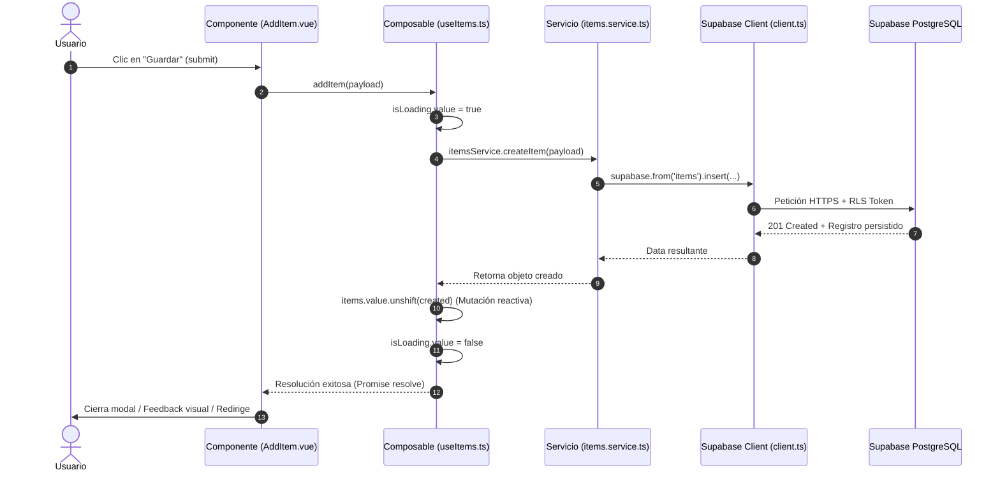

# Auditoría de Arquitectura de Software — Nakama

> **Stack Principal:** Vue 3 (Composition API) + TypeScript / JavaScript + Pinia + Vue Router + Supabase (PostgreSQL / Auth / RLS) + Vite.

Este documento sintetiza la estructura de alto nivel del proyecto, las responsabilidades de cada capa, el flujo de datos de extremo a extremo y el ciclo de vida del arranque de la aplicación.

---

## 1. El Esqueleto: Responsabilidad Única por Carpeta

La aplicación sigue una arquitectura por capas con separación estricta entre presentación, lógica reactiva, estado global y servicios de infraestructura.

| Directorio | Capa arquitectónica | Responsabilidad única |
| :--- | :--- | :--- |
| [`src/components/`](file:///home/entropy/Olimpo/proyectos/Nakama-gestor-personal/src/components/) | **Presentación (UI)** | Renderizar interfaces visuales, recibir inputs del usuario y emitir eventos. Está modularizado por dominios funcionales: `auth`, `collection`, `crew`, `dashboard`, `items` y `ui`. |
| [`src/composables/`](file:///home/entropy/Olimpo/proyectos/Nakama-gestor-personal/src/composables/) | **Lógica Reactiva Reutilizable** | Encapsular lógica de negocio asíncrona mediante la Composition API (`ref`, `computed`). Maneja banderas reactivas (`isLoading`, `error`) y coordina las llamadas a la capa de servicios. |
| [`src/stores/`](file:///home/entropy/Olimpo/proyectos/Nakama-gestor-personal/src/stores/) | **Estado Global (Pinia)** | Centralizar la información transversal y persistente que debe conservarse a través de toda la aplicación (sesión activa del usuario en `auth.ts` y tripulación seleccionada en `crew.ts`). |
| [`src/services/`](file:///home/entropy/Olimpo/proyectos/Nakama-gestor-personal/src/services/) | **Infraestructura / Red** | Desacoplar la aplicación de fuentes externas de datos. Es el único punto de contacto con el cliente de Supabase y APIs externas (búsqueda multimedia). No contiene reactividad de Vue. |
| [`src/router/`](file:///home/entropy/Olimpo/proyectos/Nakama-gestor-personal/src/router/) | **Enrutamiento (SPA)** | Mapear URLs a componentes de vista y aplicar *navigation guards* (`beforeEach`) para proteger rutas que requieren autenticación (`requiresAuth`) o que son exclusivas para invitados (`guestOnly`). |
| [`src/types/`](file:///home/entropy/Olimpo/proyectos/Nakama-gestor-personal/src/types/) | **Contratos de Dominio** | Modelar interfaces TypeScript para entidades de base de datos, filtros, payloads de inserción/edición y contratos de autenticación. |
| [`src/data/`](file:///home/entropy/Olimpo/proyectos/Nakama-gestor-personal/src/data/) | **Fixtures / Fallback** | Proveer datos iniciales de prueba (`mockItems.js`) para permitir que la aplicación funcione en modo demostración/desarrollo local sin credenciales de Supabase. |
| [`src/assets/`](file:///home/entropy/Olimpo/proyectos/Nakama-gestor-personal/src/assets/) / [`public/`](file:///home/entropy/Olimpo/proyectos/Nakama-gestor-personal/public/) | **Recursos Estáticos** | Almacenar imágenes, fondos e iconos SVG sin lógica ejecutable. |
| [`supabase/`](file:///home/entropy/Olimpo/proyectos/Nakama-gestor-personal/supabase/) | **Backend as Code** | Definir el esquema relacional SQL, migraciones y directivas de seguridad a nivel de fila (*Row Level Security* - RLS) para PostgreSQL en Supabase. |

---

## 2. El Flujo de Datos: Del Clic a Supabase

A continuación se muestra el ciclo de vida completo de una mutación (por ejemplo, guardar un nuevo ítem en la colección desde [`src/components/AddItem.vue`](file:///home/entropy/Olimpo/proyectos/Nakama-gestor-personal/src/components/AddItem.vue)):

### Detalle de las Etapas:
1. **Disparo en Presentación:** El usuario confirma el formulario en el componente UI. El componente valida los campos locales y despacha la llamada al composable.
2. **Orquestación Reactiva:** El composable activa banderas reactivas (`isLoading.value = true`, `error.value = null`), lo que inmediatamente refleja spinners o estados deshabilitados en la UI.
3. **Abstracción Técnica:** El servicio prepara la consulta a Supabase. Si Supabase no está configurado (`isSupabaseConfigured === false`), el servicio conmuta automáticamente a una memoria local (`inMemoryItems`), garantizando que la aplicación nunca falle en modo offline/demo.
4. **Persistencia Remota:** El cliente oficial de Supabase realiza la llamada HTTPS contra la base de datos PostgreSQL, respetando las políticas de seguridad RLS asociadas al usuario autenticado.
5. **Cierre de Ciclo Reactivo:** El composable recibe el nuevo ítem y ejecuta `items.value.unshift(created)`. Al ser `items` una referencia reactiva compartida (`ref`), todos los componentes montados suscritos a esa lista (como [`ItemList.vue`](file:///home/entropy/Olimpo/proyectos/Nakama-gestor-personal/src/components/ItemList.vue) o [`Dashboard.vue`](file:///home/entropy/Olimpo/proyectos/Nakama-gestor-personal/src/components/Dashboard.vue)) se re-renderizan automáticamente sin necesidad de recargar la página.

---

## 3. El Punto de Arranque

La aplicación nace a través de una secuencia de 4 pasos:

1. **Host HTML ([`index.html`](file:///home/entropy/Olimpo/proyectos/Nakama-gestor-personal/index.html)):** El navegador carga el documento base que contiene el elemento ancla `

` e importa el script principal como módulo ES: ``.
2. **Inicialización ([`src/main.js`](file:///home/entropy/Olimpo/proyectos/Nakama-gestor-personal/src/main.js)):**
   - Importa `createApp` desde Vue y `createPinia` desde Pinia.
   - Crea la instancia principal: `const app = createApp(App)`.
   - Carga la hoja de estilos global ([`src/style.css`](file:///home/entropy/Olimpo/proyectos/Nakama-gestor-personal/src/style.css)).
3. **Instalación de Plugins:**
   - Inyecta el almacén central: `app.use(pinia)`.
   - Inyecta el enrutador: `app.use(router)`.
4. **Montaje en el DOM:** Ejecuta `app.mount('#app')`, activando el ciclo de vida del componente raíz [`src/App.vue`](file:///home/entropy/Olimpo/proyectos/Nakama-gestor-personal/src/App.vue).

---

## 4. Archivo Clave Recomendado para Estudio Manual

Para dominar la arquitectura y el comportamiento reactivo de este proyecto, el archivo más representativo es:

📄 **[`src/composables/useItems.ts`](file:///home/entropy/Olimpo/proyectos/Nakama-gestor-personal/src/composables/useItems.ts)**

### Conceptos Clave que Ilustra:
* **Estado Singleton Compartido:** Declara variables `ref` a nivel de módulo (fuera de la función exportada), permitiendo que múltiples componentes compartan la misma lista en memoria sin requerir un Store formal de Pinia para este dominio.
* **Manejo de Estados Asíncronos:** Demuestra el patrón estándar de la aplicación: inicialización de `isLoading`, captura de errores en bloques `try/catch/finally` y asignación reactiva a `error.value`.
* **Mutaciones Reactivas Locales:** Emplea mutaciones directas sobre arrays (`items.value.unshift(...)`, `items.value.filter(...)`) para mantener la interfaz actualizada instantáneamente tras operaciones de escritura.
* **Separación de Responsabilidades:** Muestra la frontera limpia entre la lógica reactiva de Vue y la capa de infraestructura delegada en [`itemsService`](file:///home/entropy/Olimpo/proyectos/Nakama-gestor-personal/src/services/supabase/items.service.ts).
