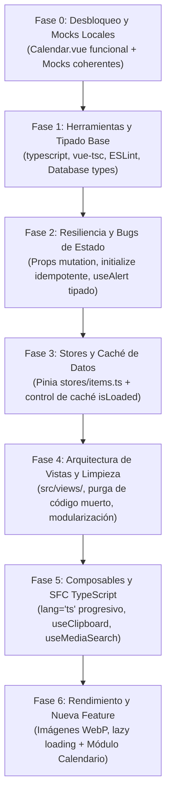

# 🛠️ Plan Maestro de Refactorización y Disolución de Deuda Técnica

> **Proyecto:** Nakama (Gestor de Medios)  
> **Directorio:** `docs/refactor/`  
> **Documento base:** [Auditoría Arquitectónica Frontend](../reportes/2026-10-04-auditoria-arquitectura.md)  
> **Guía de componentes:** [Guía de Componentes y Extensión](../02-GUIA-COMPONENTES.md)

---

## 🎯 Objetivo General

Eliminar la deuda técnica acumulada de forma metódica y segura para dotar al proyecto de:
1. **Tipado estricto real** (TypeScript compilable sin `any` ni errores en tiempo de ejecución).
2. **Eliminación de antipatrones críticos** (mutación de props, carreras de inicio de sesión, fugas de estado entre usuarios).
3. **Estructura de carpetas limpia y escalable** (`views/` para páginas, `components/` para piezas reutilizables).
4. **Modo Mock 100% fiel a producción** para desarrollar localmente sin tocar Supabase.
5. **Base arquitectónica sólida** para implementar nuevas funcionalidades (comenzando por el **Calendario de Emisiones**).

---

## 🚦 Reglas de Oro para la Ejecución (Zero Regression)

Cada agente o desarrollador que ejecute una fase **DEBE cumplir estas restricciones**:

1. **Un solo paso lógico a la vez**: Nunca mezclar refactor de estilos con refactor de lógica de datos en el mismo commit.
2. **Prohibido tocar el esquema de Base de Datos**: No alterar `supabase/schema.sql`. Todo cambio de base de datos se reserva para migraciones futuras.
3. **Verificación de Compilación Obligatoria**: Al finalizar cada fase, el comando `pnpm run build` debe pasar en 0 errores. Desde la Fase 1 en adelante, también debe pasar `pnpm run type-check`.
4. **Preservación de Contratos de Dumb Components**: No cambiar las `props` ni `emits` de los componentes en `collection/`, `dashboard/`, `items/` ni `ui/` sin actualizar simultáneamente todos los componentes que los consumen.

---

## 🗺️ Mapa de Fases de Ejecución

| Archivo de Fase | Título | Criticidad | Estado |
|---|---|:---:|:---:|
| [`fase-0-desbloqueo-y-mocks.md`](./fase-0-desbloqueo-y-mocks.md) | Desbloqueo de Compilación y Mocks Coherentes | 🔴 Inmediata | **Completado** |
| [`fase-1-herramientas-y-tipado-base.md`](./fase-1-herramientas-y-tipado-base.md) | Herramientas de Verificación y Tipado Estricto Base | 🔴 Alta | Pendiente |
| [`fase-2-resiliencia-y-bugs-de-estado.md`](./fase-2-resiliencia-y-bugs-de-estado.md) | Erradicación de Bugs Críticos de Estado y Props | 🔴 Alta | Pendiente |
| [`fase-3-stores-y-capa-de-datos.md`](./fase-3-stores-y-capa-de-datos.md) | Unificación de Stores Pinia y Control de Caché | 🟠 Media | Pendiente |
| [`fase-4-arquitectura-vistas-y-limpieza.md`](./fase-4-arquitectura-vistas-y-limpieza.md) | Reestructuración de Vistas (`src/views/`) y Purga | 🟠 Media | Pendiente |
| [`fase-5-composables-y-typescript-sfc.md`](./fase-5-composables-y-typescript-sfc.md) | Migración a `lang="ts"` y Composables Limpios | 🟡 Media-Baja | Pendiente |
| [`fase-6-optimizacion-y-nueva-feature.md`](./fase-6-optimizacion-y-nueva-feature.md) | Optimización de Assets y Creación del Calendario | 🟢 Expansión | Pendiente |
