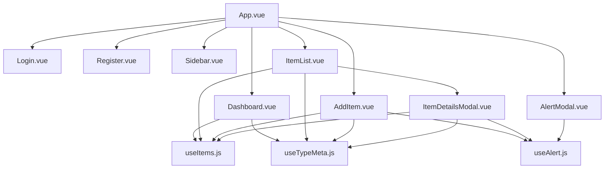

# 🔍 Auditoría Frontend — Nakama (ExLibris Gestor de Libros)

> **Fecha:** 2026-10-01  
> **Auditor:** Principal Frontend Architect  
> **Stack Evaluado:** Vue 3 (Composition API), Vite 8, CSS Custom Properties, Lucide Icons  
> **Objetivo de Integración:** Supabase (Auth + PostgreSQL + RLS)

---

## 1. DIAGNÓSTICO GENERAL Y PUNTAJES

| Pilar de Evaluación | Puntaje | Veredicto |
|---|:---:|---|
| **Modularidad de Componentes** | **4/10** | Componentes monolíticos con SRP violado. Sin Vue Router ni Pinia. Enrutamiento simulado con `v-if`. |
| **Salud y Encapsulamiento del CSS** | **7/10** | Buen sistema de tokens en `:root`. CSS `scoped` en todos los componentes. Un caso de `!important`. Duplicación significativa de estilos entre Login/Register. |
| **Preparación para Supabase** | **2/10** | **Nula.** Estado global en memoria (array hardcoded), sin funciones async, sin cliente Supabase, sin Pinia, sin Vue Router. La autenticación es simulada (emit sin validación). |

### Resumen de Métricas

```
Archivos .vue        : 12 (3 legacy + 1 boilerplate sin uso)
Archivos composable  : 3
Líneas de código     : ~3,200 (componentes) + ~224 (composables)
Dependencias         : vue, @lucide/vue (solo 2)
Faltan instalar      : pinia, vue-router, @supabase/supabase-js
Vue Router           : ❌ NO existe
Pinia                : ❌ NO existe
TypeScript           : ❌ NO existe
Tests                : ❌ NO existen
```

---

## 2. HALLAZGOS CRÍTICOS ("Deal-Breakers")

Estos son los problemas que **romperán el sistema** si se intenta conectar Supabase directamente:

### 🚨 CRÍTICO 1 — Enrutamiento Simulado con `v-if` en App.vue

```javascript
// App.vue — Líneas 11-13
const isAuthenticated = ref(false)
const authView = ref('login')    // 'login' | 'register'
const currentView = ref('dashboard') // 'dashboard' | 'list' | 'add'
```

**Riesgo:** Sin Vue Router, es imposible implementar guardias de navegación (`beforeEach`) para proteger rutas con Supabase Auth. Un refresh del navegador pierde toda la sesión. No hay historial de navegación.

---

### 🚨 CRÍTICO 2 — Estado Global en Memoria Sin Persistencia

```javascript
// useItems.js — Líneas 6-117
const items = ref([
  { id: 1, titulo: 'One Piece', tipo: 'Anime', ... },
  { id: 2, titulo: 'Attack on Titan', ... },
  // ... 8 items hardcoded
]);
```

**Riesgo:** Toda la "base de datos" vive en un `ref()` con datos mock. Al conectar Supabase:
- Las operaciones CRUD son **síncronas** (`addItem`, `deleteItem`) — no retornan Promises ni manejan errores de red.
- No existe concepto de `isLoading`, `error`, ni `data` reactivos.
- La paginación es 100% en cliente (`slice()`) — inviable con miles de registros de Supabase.

---

### 🚨 CRÍTICO 3 — Autenticación Ficticia Sin Validación

```javascript
// Login.vue — Líneas 11-13
const handleLogin = () => {
  emit('login-success'); // ¡No valida credenciales!
};
```

**Riesgo:** No hay ninguna llamada a `supabase.auth.signInWithPassword()`. El formulario emite éxito incondicional. Inyectar Supabase Auth aquí sin refactorizar primero causará:
- Errores no capturados al fallar la autenticación
- No hay estado de carga mientras Supabase responde
- No hay manejo de sesión expirada / tokens JWT

---

### 🚨 CRÍTICO 4 — Ausencia Total de Pinia

**Riesgo:** Sin Pinia, el estado de autenticación (`user`, `session`), el catálogo de items y las preferencias del usuario no tienen un punto central de verdad. El patrón singleton con `ref()` fuera del composable funciona *parcialmente*, pero:
- No es serializable (no se puede persistir en localStorage/sessionStorage)
- No tiene devtools de Vue para debugging
- No escala cuando hay múltiples stores interconectados

---

### 🚨 CRÍTICO 5 — Componentes Legacy Abandonados

Existen **3 archivos legacy** no conectados a la app pero presentes en el proyecto:

| Archivo | Líneas | Estado |
|---|:---:|---|
| `BookList.vue` | 597 | Legacy, usa datos mock propios |
| `AddBook.vue` | 466 | Legacy, no usa `useItems` |
| `BookDetailsModal.vue` | 321 | Legacy, importado solo en `BookList` |
| `HelloWorld.vue` | 96 | Boilerplate Vite, no utilizado |

**Riesgo:** Código muerto que confunde el mantenimiento y aumenta el tamaño del bundle (1,384 líneas innecesarias).

---

## 3. ANÁLISIS POR ARCHIVO / MÓDULO

### 3.1 `App.vue` — Componente Raíz

| Aspecto | Detalle |
|---|---|
| **Líneas** | 73 |
| **Problema** | Actúa como Router + Auth Guard + Layout simultáneamente |

**Problema — Enrutamiento manual:**
```html
<!-- App.vue L21-41 -->
<template v-if="!isAuthenticated">
  <Login v-if="authView === 'login'" ... />
  <Register v-else-if="authView === 'register'" ... />
</template>
<div v-else class="app-layout">
  <Dashboard v-if="currentView === 'dashboard'" ... />
  <ItemList v-else-if="currentView === 'list'" ... />
  <AddItem v-else-if="currentView === 'add'" ... />
</div>
```

**Riesgo:** Código no escalable. Cada nueva vista requiere un nuevo `v-else-if`. Imposible compartir URLs, usar deep linking o proteger rutas con middleware.

**Solución Refactorizada:**
```javascript
// router/index.js
import { createRouter, createWebHistory } from 'vue-router'

const routes = [
  { path: '/login',     name: 'Login',     component: () => import('@/views/LoginView.vue'),    meta: { requiresGuest: true } },
  { path: '/register',  name: 'Register',  component: () => import('@/views/RegisterView.vue'), meta: { requiresGuest: true } },
  { path: '/',          name: 'Dashboard',  component: () => import('@/views/DashboardView.vue'), meta: { requiresAuth: true } },
  { path: '/collection',name: 'Collection', component: () => import('@/views/CollectionView.vue'), meta: { requiresAuth: true } },
  { path: '/add',       name: 'AddItem',    component: () => import('@/views/AddItemView.vue'),    meta: { requiresAuth: true } },
]

const router = createRouter({ history: createWebHistory(), routes })

router.beforeEach(async (to) => {
  const auth = useAuthStore()
  if (to.meta.requiresAuth && !auth.user) return { name: 'Login' }
  if (to.meta.requiresGuest && auth.user) return { name: 'Dashboard' }
})

export default router
```

```html
<!-- App.vue refactorizado -->
<template>
  <div class="app-layout" v-if="authStore.user">
    <Sidebar />
    <main class="main-content">
      <RouterView />
    </main>
  </div>
  <RouterView v-else />
  <AlertModal />
</template>
```

---

### 3.2 `useItems.js` — Composable de Datos

| Aspecto | Detalle |
|---|---|
| **Líneas** | 141 |
| **Problema** | Base de datos in-memory, operaciones síncronas, sin tipos |

**Problema — CRUD síncrono sin manejo de errores:**
```javascript
// useItems.js L120-128
const addItem = (newItem) => {
  const maxId = items.value.length > 0
    ? Math.max(...items.value.map(i => i.id))
    : 0;
  items.value.push({ ...newItem, id: maxId + 1 });
};

const deleteItem = (id) => {
  items.value = items.value.filter(i => i.id !== id);
};
```

**Riesgo:** Cuando `addItem` se conecte a Supabase, la operación será asíncrona y puede fallar. El código actual no tiene `try/catch`, ni `isLoading`, ni rollback.

**Solución Refactorizada (Pinia Store + Service Layer):**

```javascript
// services/supabase/items.service.js
import { supabase } from '@/lib/supabaseClient'

export const itemsService = {
  async fetchAll({ page = 1, perPage = 18, tipo, estado, search }) {
    let query = supabase.from('items').select('*', { count: 'exact' })
    if (tipo && tipo !== 'Todos') query = query.eq('tipo', tipo)
    if (estado && estado !== 'Todos') query = query.eq('estado', estado)
    if (search) query = query.ilike('titulo', `%${search}%`)
    query = query.range((page - 1) * perPage, page * perPage - 1)
           .order('id', { ascending: false })
    const { data, error, count } = await query
    if (error) throw error
    return { data, count }
  },

  async create(item) {
    const { data, error } = await supabase.from('items').insert(item).select().single()
    if (error) throw error
    return data
  },

  async remove(id) {
    const { error } = await supabase.from('items').delete().eq('id', id)
    if (error) throw error
  },

  async update(id, changes) {
    const { data, error } = await supabase.from('items').update(changes).eq('id', id).select().single()
    if (error) throw error
    return data
  },
}
```

```javascript
// stores/items.store.js
import { defineStore } from 'pinia'
import { itemsService } from '@/services/supabase/items.service'

export const useItemsStore = defineStore('items', {
  state: () => ({
    items: [],
    totalCount: 0,
    isLoading: false,
    error: null,
  }),
  actions: {
    async fetchItems(filters = {}) {
      this.isLoading = true
      this.error = null
      try {
        const { data, count } = await itemsService.fetchAll(filters)
        this.items = data
        this.totalCount = count
      } catch (err) {
        this.error = err.message
      } finally {
        this.isLoading = false
      }
    },
    async addItem(item) {
      this.isLoading = true
      try {
        const created = await itemsService.create(item)
        this.items.unshift(created)
        this.totalCount++
        return created
      } catch (err) {
        this.error = err.message
        throw err
      } finally {
        this.isLoading = false
      }
    },
    async deleteItem(id) {
      try {
        await itemsService.remove(id)
        this.items = this.items.filter(i => i.id !== id)
        this.totalCount--
      } catch (err) {
        this.error = err.message
        throw err
      }
    },
  },
})
```

---

### 3.3 `Login.vue` y `Register.vue` — Autenticación

| Aspecto | Login | Register |
|---|---|---|
| **Líneas** | 257 | 166 |
| **Problema** | Auth simulada | Auth simulada |

**Problema — Duplicación masiva de CSS (~80% idéntico):**

Ambos componentes replican estos bloques de estilos:
- `.brand`, `.brand-icon`, `.brand-text`, `.brand-name`, `.brand-sub`
- `.form`, `.form-group`, `.input-field`, `.form-links`, `.link`
- `.submit-btn`, `.login-deco`, Layout responsivo

**Riesgo:** Cambiar un color o padding del formulario requiere editar ambos archivos. Al agregar OAuth (Google, GitHub), la duplicación se triplicará.

**Solución:**
```
components/
  auth/
    AuthLayout.vue           ← Layout compartido (deco + wrapper)
    AuthBrand.vue            ← Logo + tagline
    LoginForm.vue            ← Solo el <form> de login
    RegisterForm.vue         ← Solo el <form> de registro
```

---

### 3.4 `Dashboard.vue` — Vista Principal

| Aspecto | Detalle |
|---|---|
| **Líneas** | 407 |
| **Problema** | Componente monolítico que debería ser 4+ componentes |

**Problema — Computados repetitivos para estadísticas:**
```javascript
// Dashboard.vue L10-23
const totalByType = computed(() => ({
  anime:    items.value.filter(i => i.tipo === 'Anime').length,
  manga:    items.value.filter(i => i.tipo === 'Manga').length,
  series:   items.value.filter(i => i.tipo === 'Serie').length,
  pelicula: items.value.filter(i => i.tipo === 'Película').length,
}));

const totalByStatus = computed(() => ({
  'Viendo':     items.value.filter(i => i.estado === 'Viendo').length,
  'Completado': items.value.filter(i => i.estado === 'Completado').length,
  // ... 3 más
}));
```

**Riesgo:** 9 iteraciones completas del array en cada re-render. Con Supabase, estos conteos deberían obtenerse como `COUNT()` en SQL o como un RPC dedicado, no iterando el array completo en el cliente.

**Solución — Descomposición en sub-componentes:**
```
views/
  DashboardView.vue          ← Orquestador (smart component)
components/
  dashboard/
    WelcomeHeader.vue         ← Saludo + CTA
    StatCardGrid.vue          ← Grid de estadísticas por tipo
    StatCard.vue              ← Tarjeta individual (dumb, props only)
    StatusPillBar.vue         ← Pastillas de estado
    RecentItemsGrid.vue       ← Grid de recientes
    RecentItemCard.vue        ← Tarjeta de reciente (dumb)
    EmptyState.vue            ← Estado vacío reutilizable
```

---

### 3.5 `ItemList.vue` — Listado y Filtrado

| Aspecto | Detalle |
|---|---|
| **Líneas** | 374 |
| **Problema** | Filtrado, paginación y rendering en un solo archivo |

**Problema — Duplicación de constantes (también en `AddItem.vue`):**
```javascript
// ItemList.vue L11-24 — DUPLICADO
const TIPOS   = ['Todos', 'Anime', 'Manga', 'Serie', 'Película'];
const ESTADOS = ['Todos', 'Viendo', 'Completado', 'Pendiente', 'Abandonado', 'En Pausa'];
const STATUS_COLORS = {
  'Viendo':     'var(--state-watching)',
  // ... idéntico al de AddItem.vue
};
```

**Riesgo:** Al agregar un nuevo tipo/estado en Supabase, habrá que buscar y actualizar en múltiples archivos.

**Problema — `!important` en CSS:**
```css
/* ItemList.vue L311 */
.card-type { color: #FFFFFF !important; }
```

**Riesgo:** Indica un conflicto de especificidad no resuelto. El `!important` enmascara el problema real.

---

### 3.6 `Sidebar.vue` — Navegación

| Aspecto | Detalle |
|---|---|
| **Líneas** | 376 |
| **Problema** | Logout inerte, navegación sin router |

**Problema — Cerrar sesión no funciona:**
```html
<!-- Sidebar.vue L37 -->
<a href="#" class="logout-link">Cerrar sesión</a>
```

**Riesgo:** El `href="#"` no hace nada. Al integrar Supabase Auth, necesita llamar `supabase.auth.signOut()` y redirigir.

---

### 3.7 `useAlert.js` — Composable de Alertas

| Aspecto | Detalle |
|---|---|
| **Líneas** | 46 |
| **Veredicto** | ✅ Bien diseñado |

Este composable es el más limpio del proyecto. El patrón singleton con `reactive()` + Promise es elegante y funcional. Solo necesita migrarse a un Pinia store si el resto del estado se unifica.

---

### 3.8 `useTypeMeta.js` — Metadatos de UI

| Aspecto | Detalle |
|---|---|
| **Líneas** | 37 |
| **Veredicto** | ✅ Excelente abstracción |

Centraliza colores e iconos por tipo/estado. Es el archivo más preparado para Supabase ya que no tiene acoplamiento a datos.

**Observación menor:** Todos los colores en `TYPE_META` y `TYPE_TABS_META` son `#FFFFFF`, lo cual podría ser intencional (monocromo) o un placeholder que nunca se actualizó.

---

### 3.9 `AlertModal.vue` — Modal de Alertas

| Aspecto | Detalle |
|---|---|
| **Líneas** | 210 |
| **Problema menor** | `z-index: 9999` — debería usarse un sistema de capas |

---

### 3.10 Archivos Legacy / Dead Code

| Archivo | Líneas | Acción Requerida |
|---|:---:|---|
| `BookList.vue` | 597 | 🗑️ Eliminar |
| `AddBook.vue` | 466 | 🗑️ Eliminar |
| `BookDetailsModal.vue` | 321 | 🗑️ Eliminar |
| `HelloWorld.vue` | 96 | 🗑️ Eliminar |
| `assets/hero.png` | — | 🗑️ Eliminar |
| `assets/vite.svg` | — | 🗑️ Eliminar |
| `assets/vue.svg` | — | 🗑️ Eliminar |
| `assets/logo.png` | — | 🗑️ Verificar si se usa |

**Total de código muerto: ~1,480 líneas + ~250 KB de assets.**

---

## 4. ESTRUCTURA DE DIRECTORIOS RECOMENDADA

```
frontend/src/
├── App.vue                          ← Layout raíz mínimo (<RouterView> + <AlertModal>)
├── main.js                          ← Inicializa Vue + Pinia + Router
├── style.css                        ← Solo tokens (:root) + reset
│
├── assets/
│   ├── images/
│   │   ├── fondo_login.jpg
│   │   ├── fondo_registro.png
│   │   └── katana_logo.png
│   └── styles/
│       ├── tokens.css               ← Variables CSS extraídas de style.css
│       ├── reset.css                ← Box-sizing, margin, scrollbar
│       ├── typography.css           ← Fuentes, headings
│       └── forms.css                ← Inputs, textareas, selects
│
├── lib/
│   └── supabaseClient.js            ← Instancia singleton del cliente Supabase
│
├── services/
│   └── supabase/
│       ├── auth.service.js           ← signIn, signUp, signOut, onAuthStateChange
│       ├── items.service.js          ← CRUD de items (queries a Supabase)
│       └── storage.service.js        ← Upload de portadas a Supabase Storage
│
├── stores/
│   ├── auth.store.js                 ← Pinia: user, session, isAuthenticated
│   ├── items.store.js                ← Pinia: items[], isLoading, error, CRUD
│   └── alert.store.js                ← Pinia: migración de useAlert
│
├── router/
│   ├── index.js                      ← Definición de rutas
│   └── guards.js                     ← beforeEach (auth guard)
│
├── composables/
│   ├── useTypeMeta.js                ← (conservar tal cual — excelente)
│   └── useFilters.js                 ← Lógica de filtrado/paginación reutilizable
│
├── views/                            ← Smart components (páginas)
│   ├── LoginView.vue
│   ├── RegisterView.vue
│   ├── DashboardView.vue
│   ├── CollectionView.vue
│   └── AddItemView.vue
│
├── components/                       ← Dumb components (UI reutilizable)
│   ├── layout/
│   │   ├── AppSidebar.vue
│   │   └── AppLayout.vue
│   ├── auth/
│   │   ├── AuthLayout.vue            ← Wrapper compartido Login/Register
│   │   └── AuthBrand.vue             ← Logo + tagline
│   ├── dashboard/
│   │   ├── StatCard.vue
│   │   ├── StatCardGrid.vue
│   │   ├── StatusPillBar.vue
│   │   ├── RecentItemCard.vue
│   │   └── RecentItemsGrid.vue
│   ├── collection/
│   │   ├── ItemCard.vue
│   │   ├── ItemGrid.vue
│   │   ├── FilterTabs.vue
│   │   ├── StatusFilter.vue
│   │   └── SearchBar.vue
│   ├── items/
│   │   ├── ItemForm.vue              ← Formulario unificado (crear/editar)
│   │   ├── TypeSelector.vue
│   │   ├── StatusSelector.vue
│   │   ├── ScoreSelector.vue
│   │   └── CoverPreview.vue
│   └── ui/
│       ├── AlertModal.vue
│       ├── ItemDetailsModal.vue
│       ├── EmptyState.vue
│       ├── LoadingSpinner.vue        ← NUEVO: para estados de carga
│       ├── SkeletonCard.vue          ← NUEVO: skeleton loader
│       └── ErrorBanner.vue           ← NUEVO: banner de errores
│
└── types/                            ← (Futuro) TypeScript interfaces
    ├── item.d.ts
    ├── auth.d.ts
    └── supabase.d.ts
```

---

## 5. PLAN DE REFACTORIZACIÓN EJECUTABLE

### FASE 1: Limpieza de UI y CSS (Zero-Impact en lógica)

> **Objetivo:** Reducir deuda técnica visual y modularizar componentes sin tocar la lógica de datos.  
> **Riesgo de ruptura:** ⬇️ Muy bajo  
> **Duración estimada:** 3-5 días

- [ ] **1.1** Eliminar archivos legacy y dead code
  - Borrar `BookList.vue`, `AddBook.vue`, `BookDetailsModal.vue`, `HelloWorld.vue`
  - Borrar assets no utilizados: `hero.png`, `vite.svg`, `vue.svg`
  - Verificar y potencialmente eliminar `logo.png`

- [ ] **1.2** Modularizar `style.css` en archivos separados
  - Extraer tokens (`:root`) → `assets/styles/tokens.css`
  - Extraer reset → `assets/styles/reset.css`
  - Extraer tipografía → `assets/styles/typography.css`
  - Extraer formularios → `assets/styles/forms.css`
  - `style.css` queda como barrel: `@import` de todos los módulos

- [ ] **1.3** Eliminar `!important` en `ItemList.vue` (L311)
  - Investigar la causa raíz del conflicto de especificidad
  - Corregir con selectores más específicos o CSS custom properties

- [ ] **1.4** Consolidar constantes duplicadas
  - Mover `TIPOS`, `ESTADOS`, `STATUS_COLORS` a `useTypeMeta.js`
  - Actualizar imports en `ItemList.vue`, `AddItem.vue`

- [ ] **1.5** Extraer CSS compartido entre Login y Register
  - Crear `AuthLayout.vue` con el layout deco + form wrapper
  - Crear `AuthBrand.vue` con logo + tagline
  - Reducir Login/Register a solo su `<form>` específico

- [ ] **1.6** Descomponer `Dashboard.vue` (407 líneas) en sub-componentes
  - `WelcomeHeader.vue` — saludo + CTA
  - `StatCard.vue` — tarjeta individual (props: icon, count, label, color)
  - `StatusPillBar.vue` — pastillas de estado
  - `RecentItemCard.vue` — tarjeta de reciente
  - `EmptyState.vue` — estado vacío reutilizable

- [ ] **1.7** Extraer sub-componentes de `ItemList.vue`
  - `FilterTabs.vue` — tabs de tipo
  - `StatusFilter.vue` — filtro por estado
  - `SearchBar.vue` — barra de búsqueda
  - `ItemCard.vue` — tarjeta individual
  - `ItemGrid.vue` — grid contenedor

- [ ] **1.8** Extraer sub-componentes de `AddItem.vue`
  - `TypeSelector.vue`, `StatusSelector.vue`, `ScoreSelector.vue`
  - `CoverPreview.vue`

---

### FASE 2: Construcción de la Capa de Abstracción (Data Layer)

> **Objetivo:** Crear la infraestructura para Supabase sin romper la funcionalidad actual.  
> **Riesgo de ruptura:** ⬇️ Bajo (se usan datos mock como fallback)  
> **Duración estimada:** 3-4 días

- [ ] **2.1** Instalar dependencias
  ```bash
  npm install pinia vue-router @supabase/supabase-js
  ```

- [ ] **2.2** Crear el cliente Supabase
  ```javascript
  // lib/supabaseClient.js
  import { createClient } from '@supabase/supabase-js'

  const supabaseUrl = import.meta.env.VITE_SUPABASE_URL
  const supabaseKey = import.meta.env.VITE_SUPABASE_ANON_KEY

  export const supabase = createClient(supabaseUrl, supabaseKey)
  ```

- [ ] **2.3** Crear Service Layer con fallback a datos mock
  ```javascript
  // services/supabase/items.service.js
  import { supabase } from '@/lib/supabaseClient'
  import { MOCK_ITEMS } from '@/data/mockItems'

  const USE_MOCK = !import.meta.env.VITE_SUPABASE_URL

  export const itemsService = {
    async fetchAll(filters) {
      if (USE_MOCK) return { data: MOCK_ITEMS, count: MOCK_ITEMS.length }
      // ... query real a Supabase
    },
    // ...
  }
  ```

- [ ] **2.4** Crear Pinia stores
  - `stores/items.store.js` — con `isLoading`, `error`, `items`, acciones async
  - `stores/alert.store.js` — migración de `useAlert.js`
  - `stores/auth.store.js` — placeholder con `user`, `session`, `isAuthenticated`

- [ ] **2.5** Crear componentes de UX para estados asíncronos
  - `LoadingSpinner.vue` — spinner reutilizable
  - `SkeletonCard.vue` — skeleton con la forma de ItemCard
  - `ErrorBanner.vue` — banner con botón de reintentar

- [ ] **2.6** Migrar `useItems()` → `useItemsStore()`
  - Los componentes ahora consumen `const store = useItemsStore()`
  - `store.items`, `store.isLoading`, `store.error`
  - `store.fetchItems()`, `store.addItem()`, `store.deleteItem()`

- [ ] **2.7** Extraer datos mock a archivo separado
  - Mover array de items hardcoded de `useItems.js` → `data/mockItems.js`

---

### FASE 3: Integración de Vue Router y Autenticación

> **Objetivo:** Reemplazar el enrutamiento con `v-if` por Vue Router y conectar Supabase Auth.  
> **Riesgo de ruptura:** ⬆️ Medio (cambio estructural)  
> **Duración estimada:** 3-4 días

- [ ] **3.1** Configurar Vue Router
  - Crear `router/index.js` con rutas para Login, Register, Dashboard, Collection, AddItem
  - Crear `router/guards.js` con `beforeEach` que verifica `auth.user`
  - Registrar router en `main.js`

- [ ] **3.2** Crear views (Smart Components)
  - `views/LoginView.vue` — wrapper con AuthLayout + LoginForm
  - `views/RegisterView.vue` — wrapper con AuthLayout + RegisterForm
  - `views/DashboardView.vue` — orquesta sub-componentes de dashboard
  - `views/CollectionView.vue` — orquesta filtros + grid
  - `views/AddItemView.vue` — orquesta formulario

- [ ] **3.3** Refactorizar `App.vue`
  - Eliminar toda la lógica de `v-if` para vistas
  - Reemplazar por `<RouterView />`
  - Mantener solo layout + AlertModal

- [ ] **3.4** Crear `auth.service.js`
  ```javascript
  // services/supabase/auth.service.js
  import { supabase } from '@/lib/supabaseClient'

  export const authService = {
    async signIn(email, password) {
      const { data, error } = await supabase.auth.signInWithPassword({ email, password })
      if (error) throw error
      return data
    },
    async signUp(email, password, metadata = {}) {
      const { data, error } = await supabase.auth.signUp({ email, password, options: { data: metadata } })
      if (error) throw error
      return data
    },
    async signOut() {
      const { error } = await supabase.auth.signOut()
      if (error) throw error
    },
    onAuthStateChange(callback) {
      return supabase.auth.onAuthStateChange(callback)
    },
  }
  ```

- [ ] **3.5** Implementar `auth.store.js` (Pinia)
  - Estado: `user`, `session`, `isLoading`, `error`
  - Acciones: `login()`, `register()`, `logout()`, `initialize()`
  - `initialize()` se llama en `App.vue` `onMounted()` para restaurar sesión

- [ ] **3.6** Conectar Sidebar logout
  - Reemplazar `<a href="#">Cerrar sesión</a>` por `@click="authStore.logout()"`

- [ ] **3.7** Actualizar navegación del Sidebar
  - Reemplazar `$emit('change-view', 'dashboard')` por `router.push({ name: 'Dashboard' })`

---

### FASE 4: Conexión Progresiva Módulo por Módulo

> **Objetivo:** Sustituir mock data por queries reales a Supabase sin detener desarrollo.  
> **Riesgo de ruptura:** ⬆️ Medio (requiere Supabase configurado)  
> **Duración estimada:** 5-7 días

- [ ] **4.1** Crear proyecto en Supabase
  - Configurar tablas: `items`, `profiles`
  - Habilitar RLS con políticas por `auth.uid()`
  - Crear `.env` con `VITE_SUPABASE_URL` y `VITE_SUPABASE_ANON_KEY`

- [ ] **4.2** Módulo AUTH — Conectar Login y Register
  - `LoginForm.vue` → llama `authStore.login(email, password)`
  - `RegisterForm.vue` → llama `authStore.register(email, password, { username })`
  - Agregar estados de carga y mensajes de error
  - Validación de email/password en el frontend

- [ ] **4.3** Módulo ITEMS — Lectura (fetch)
  - `CollectionView.vue` → al montar, `itemsStore.fetchItems()`
  - `DashboardView.vue` → estadísticas vía `itemsStore` o RPC de Supabase
  - Implementar skeleton loaders durante la carga
  - Implementar paginación del lado del servidor

- [ ] **4.4** Módulo ITEMS — Escritura (create/delete/update)
  - `AddItemView.vue` → `itemsStore.addItem()` con `try/catch` y feedback
  - `ItemDetailsModal.vue` → `itemsStore.deleteItem()` con confirmación
  - Manejar errores de RLS (403) con mensajes claros al usuario

- [ ] **4.5** Módulo STORAGE — Portadas
  - Reemplazar URL de portada por upload a Supabase Storage
  - Crear `storage.service.js` para subir/obtener URLs públicas
  - Actualizar `CoverPreview.vue` para preview local antes de upload

- [ ] **4.6** Eliminar feature flag `USE_MOCK`
  - Una vez que todos los módulos están conectados
  - Eliminar `data/mockItems.js`
  - Eliminar fallbacks mock de los services

- [ ] **4.7** Configurar Error Handler global
  ```javascript
  // main.js
  app.config.errorHandler = (err, vm, info) => {
    console.error('Global error:', err, info)
    // Opcionalmente: enviar a un servicio de monitoreo
  }
  ```

- [ ] **4.8** Testing básico
  - Verificar flujo completo: Register → Login → Add Item → View → Delete
  - Verificar sesión persistente tras refresh
  - Verificar RLS: un usuario no puede ver items de otro
  - Verificar estados de error: red desconectada, sesión expirada

---

## APÉNDICE A — Mapa de Dependencias Actual



## APÉNDICE B — Checklist Rápido de Prioridades

| Prioridad | Acción | Fase |
|:---:|---|:---:|
| 🔴 P0 | Instalar `pinia`, `vue-router`, `@supabase/supabase-js` | 2 |
| 🔴 P0 | Eliminar archivos legacy (4 archivos, 1,480 líneas) | 1 |
| 🔴 P0 | Reemplazar enrutamiento `v-if` por Vue Router | 3 |
| 🟠 P1 | Crear Service Layer con `items.service.js` y `auth.service.js` | 2 |
| 🟠 P1 | Migrar `useItems` singleton → Pinia `useItemsStore` | 2 |
| 🟠 P1 | Implementar auth real con `supabase.auth` | 3 |
| 🟡 P2 | Descomponer Dashboard (407L) en sub-componentes | 1 |
| 🟡 P2 | Extraer componentes compartidos de Login/Register | 1 |
| 🟡 P2 | Crear componentes de UX: Spinner, Skeleton, ErrorBanner | 2 |
| 🟢 P3 | Modularizar `style.css` en tokens/reset/forms | 1 |
| 🟢 P3 | Consolidar constantes duplicadas (`TIPOS`, `STATUS_COLORS`) | 1 |
| 🟢 P3 | Eliminar `!important` y resolver conflictos de especificidad | 1 |
| 🟢 P3 | Configurar `app.config.errorHandler` global | 4 |
| 🔵 P4 | Migrar a TypeScript (interfaces para items, auth) | Post-Fase 4 |
| 🔵 P4 | Implementar tests unitarios / e2e | Post-Fase 4 |

---

> **Nota Final:** La base visual del proyecto es sólida — el sistema de tokens CSS, el diseño de UI y la temática son de alta calidad. Los problemas son exclusivamente **arquitectónicos y de data layer**. Con las 4 fases propuestas, la transición a Supabase será segura e incremental sin necesidad de rehacer la interfaz visual.

