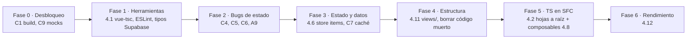

# 🏛️ Auditoría Arquitectónica Frontend — Nakama

> **Fecha:** 2026-10-04
> **Rama auditada:** `feature/calendario` (base `945ad47`, igual a `origin/main`, más cambios locales sin commit)
> **Stack:** Vue 3.5 (`<script setup>`) · Vite 8 (Rolldown) · Pinia · Vue Router · Supabase JS v2 · Tailwind CSS v4
> **Alcance:** Todo `src/`, configuración raíz (`package.json`, `tsconfig*.json`, `vite.config.js`, `vercel.json`, `index.html`).
> **Fuera de alcance (por decisión del proyecto):** cambios en el esquema de base de datos (`supabase/schema.sql`). Los hallazgos que requieren migración se documentan aparte como **"requiere migración"** y no se proponen cambios SQL.
>
> 📘 Documento complementario: [Guía de componentes y cómo añadir funcionalidades](../02-GUIA-COMPONENTES.md)

---

## 0. Cómo se hizo esta auditoría

| Paso | Qué se revisó | Evidencia |
|---|---|---|
| 1. Configuración | `package.json`, `tsconfig.json`, `tsconfig.node.json`, `vite.config.js`, `vite-env.d.ts`, `.env.example`, `index.html`, `style.css` | Lectura directa + `pnpm run build` |
| 2. Arquitectura y rutas | Árbol `src/` (49 archivos, ~6.900 líneas), grafo de imports, `router/index.ts`, `App.vue` | `grep` de imports, conteo de líneas |
| 3. Estado | `stores/auth.ts`, `stores/crew.ts`, `composables/useItems.ts`, `composables/useAlert.js` | Lectura completa |
| 4. Componentes | Los 27 SFC (`<script>` completos de los Smart, contratos `props/emits` de todos los Dumb) | Lectura + `grep` |
| 5. Tipado | `types/*.ts`, uso de `any`, `lang="ts"` en SFC, herramientas de type-check | `grep` |

**Datos medidos:**

```text
Archivos .vue                     : 27  → 0 con lang="ts"  (100 % JavaScript sin tipar)
Archivos .ts                      : 14
Archivos .js en src               : 5   (main.js, useAlert.js, useItems.js, useTypeMeta.js, mockItems.js)
Usos de `any`                     : 30
`typescript` / `vue-tsc` instalado : ❌ / ❌  (node_modules/.bin solo tiene vite, rolldown, jiti)
ESLint / Prettier / Tests         : ❌ / ❌ / ❌
Bloques <style> en SFC            : 0   (100 % Tailwind)
Imports de supabase en .vue       : 0   ✅ (la capa de servicios se respeta)
Imágenes con loading="lazy"       : 0 de 13
Uso del alias '@/'                : 0   (configurado pero sin usar)
Build actual (`pnpm run build`)   : ❌ FALLA (ver C1)
```

---

## 1. Resumen Ejecutivo

| Pilar | Puntuación | Diagnóstico |
|---|:---:|---|
| **Mantenibilidad** | **5 / 10** | La capa de datos está bien separada (Componente → Composable/Store → Servicio) y los componentes presentacionales están bien extraídos. Pero las vistas de ruta viven mezcladas con los componentes en `src/components/`, hay ~430 líneas de código muerto (`CrewModal.vue`), lógica duplicada (copiar enlace ×3, filtro por ámbito ×2, `try/catch + showAlert` ×20) y contratos heredados de antes del router que nadie escucha. |
| **Tipado** | **2 / 10** | `tsconfig.json` tiene `strict: true`, **pero no se aplica nunca**: no hay `typescript` ni `vue-tsc` instalados, ningún `.vue` usa `lang="ts"` y Vite solo *elimina* tipos, no los comprueba. El tipo `Database` está incompleto (no incluye las tablas de tripulación), así que el cliente tipado de Supabase no puede proteger las consultas de `crew.service.ts`. Hay 30 `any`. |
| **Rendimiento** | **5 / 10** | Las rutas usan *lazy loading* ✅ y Tailwind v4 genera CSS compacto ✅. Pero los fondos de login/registro pesan **8 MB** (6,2 MB + 1,7 MB), ninguna portada usa `loading="lazy"`, Google Fonts se carga con un `@import` que bloquea el render, y los ítems y la tripulación se vuelven a pedir en cada navegación y en cada `TOKEN_REFRESHED`. |

**Veredicto:** la arquitectura base es buena y fácil de enderezar. Lo urgente no es reescribir, sino **activar las herramientas que ya se dan por hechas** (type-check y lint), **arreglar 4 bugs reales** (build roto, mutación de props, estado que sobrevive al logout, carrera en `initialize`) y **ordenar las carpetas** antes de que crezcan más funcionalidades como el Calendario.

---

## 2. Hallazgos Críticos (Prioridad Alta)

### C1 — El build está roto en la rama actual
- **Archivo:** [`src/components/Calendar.vue`](../../src/components/Calendar.vue) (0 bytes) + [`src/router/index.ts`](../../src/router/index.ts#L33-L42)
- **Evidencia:** `pnpm run build` → `At least one <template> or <script> is required in a single file component. …/Calendar.vue`
- **Impacto:** si esta rama se fusiona con `main`, **Vercel no podrá desplegar**.
- **Acción:** dar al componente al menos un `<template>` mínimo, o quitar la ruta `/calendar` hasta que esté lista. Añadir `pnpm run build` como comprobación obligatoria antes de cada merge (ver §4.1).

### C2 — TypeScript "decorativo": `strict` nunca se ejecuta
- **Archivos:** [`package.json`](../../package.json), [`tsconfig.json`](../../tsconfig.json), los 27 `.vue`
- **Problema:** no hay compilador de tipos en el proyecto. Vite (Rolldown/Oxc) **solo elimina** las anotaciones; cualquier error de tipos llega a producción sin aviso. Además, todos los SFC están en JavaScript puro, así que props, emits y estado local no tienen ningún contrato.
- **Consecuencia ya visible:** [`types/items.ts`](../../src/types/items.ts#L17-L36) ya no tiene `categoria`/`etiquetas`, pero [`AddItem.vue`](../../src/components/AddItem.vue#L40-L55) los sigue enviando (líneas 53-54 y 144). Con type-check, esto saldría como error de compilación.
- **Acción:** §4.1 (herramientas) y §4.2 (migración progresiva a `lang="ts"`).

### C3 — El tipo `Database` está incompleto: el cliente tipado de Supabase no protege las consultas de tripulación
- **Archivo:** [`src/types/database.ts`](../../src/types/database.ts#L11-L50)
- **Problema:** solo declara `items` y `profiles` (y a `profiles` le falta `genero`). Faltan `crews`, `crew_members` y `crew_invites`, la función RPC `delete_user_account` y el bloque `Relationships` que exige el tipo genérico de `postgrest-js`. Por eso [`crew.service.ts`](../../src/services/supabase/crew.service.ts) tiene que usar `any` y `as Crew` en todas partes.
- **Acción:** generar los tipos desde el esquema existente (**solo lee la base de datos, no la modifica**):
  ```bash
  npx supabase gen types typescript --project-id <ID_PROYECTO> > src/types/database.generated.ts
  ```
  y derivar `Item`, `Crew`, etc. de ahí (§4.3).

### C4 — Mutación directa de props en `ItemDetailsModal.vue`
- **Archivo:** [`src/components/ItemDetailsModal.vue`](../../src/components/ItemDetailsModal.vue#L95-L151) — líneas 100, 113 y 137
- **Código actual:**
  ```js
  await updateItem(props.item.id, { progreso: next })
  props.item.progreso = next            // ❌ muta la prop
  ...
  Object.assign(props.item, updates)    // ❌ muta la prop
  ```
- **Por qué es grave:** `useItems.updateItem()` **reemplaza** el objeto en el array (`items.value[index] = { ...updated }`). `ItemList` guarda en `selectedItem` la referencia **vieja**, así que el modal solo se ve "sincronizado" gracias a la mutación. Rompe el flujo de datos en un solo sentido, Vue lo marca como antipatrón y se romperá en cuanto la prop sea `readonly` (por ejemplo, al tiparla).
- **Acción:** §4.4.

### C5 — Carrera en `authStore.initialize()` y llamadas a Supabase dentro de `onAuthStateChange`
- **Archivo:** [`src/stores/auth.ts`](../../src/stores/auth.ts#L67-L104)
- **Problema 1 (carrera):** `initialize()` se llama a la vez desde el *guard* del router ([`router/index.ts`](../../src/router/index.ts#L68-L74)) y desde `App.vue` (`onMounted`). La guarda `if (isInitialized.value) return` solo protege **cuando la primera llamada ya terminó**; mientras está en curso, la segunda vuelve a ejecutar `getSession()` + `getUser()` y puede registrar **dos** listeners de auth.
- **Problema 2 (deadlock):** el callback de `onAuthStateChange` hace `await fetchProfile()`, que consulta `supabase.from('profiles')`. La documentación de supabase-js v2 advierte que **no hay que esperar llamadas a Supabase dentro de ese callback**, porque puede bloquear el cliente (el bloqueo interno de sesión sigue tomado).
- **Acción:** guardar la promesa en curso y diferir el trabajo asíncrono (§4.5).

### C6 — El estado de un usuario sobrevive al cerrar sesión (fuga entre cuentas)
- **Archivos:** [`src/stores/auth.ts`](../../src/stores/auth.ts#L169-L183), [`src/stores/crew.ts`](../../src/stores/crew.ts#L7-L13)
- **Problema:** `signOut()` y `deleteAccount()` limpian `user/session/profile`, pero **no** el store `crew`. Si en el mismo navegador entra otro usuario, el punto de "invitación pendiente" del Sidebar y los datos de la tripulación anterior siguen ahí hasta que alguna vista llame a `loadCrewData()`. Los ítems sí se limpian, pero desde un listener suelto de otro módulo ([`useItems.ts`](../../src/composables/useItems.ts#L129-L142)), lo que deja dos mecanismos de limpieza distintos.
- **Acción:** reinicio centralizado, reaccionando al cambio de `user.id` (§4.5).

### C7 — Peticiones redundantes en cada navegación y en cada refresco de token
- **Archivos:** [`useItems.ts`](../../src/composables/useItems.ts#L129-L136), [`Dashboard.vue`](../../src/components/Dashboard.vue#L33-L42), [`ItemList.vue`](../../src/components/ItemList.vue#L31-L40), [`CrewView.vue`](../../src/components/crew/CrewView.vue#L64-L66), [`stores/crew.ts`](../../src/stores/crew.ts#L35-L71)
- **Problema:**
  - `loadItems()` se lanza en `SIGNED_IN`, `INITIAL_SESSION` **y `TOKEN_REFRESHED`**: se vuelve a descargar **toda** la colección cada vez que se renueva el token (≈ cada hora, y también al volver a la pestaña).
  - `loadCrewData()` (3-4 consultas encadenadas) se ejecuta en el `onMounted` de **Dashboard, ItemList y CrewView**, es decir, en cada cambio de vista.
  - La colección se descarga entera y se filtra/pagina en el cliente, aunque `items.service.ts` ya permite paginar en el servidor (`page/perPage`).
- **Acción:** §4.6 (marca `isLoaded` + carga forzada explícita y eventos filtrados).

### C8 — 8 MB de imágenes en las pantallas de autenticación
- **Archivos:** `src/assets/fondo_login.jpg` (**6,28 MB**), `src/assets/fondo_registro.png` (**1,74 MB**), `src/assets/logo.png` (232 KB, **no se usa en ningún sitio**)
- **Impacto:** la primera pantalla que ve cualquier usuario nuevo es la más pesada de toda la app. En móvil con 4G esto supone varios segundos de LCP (encaja con el aviso anterior de que "el botón de Discord tarda mucho en móvil").
- **Acción:** convertir a WebP/AVIF a ~1920 px de ancho (objetivo < 250 KB cada una), borrar `logo.png` y añadir `loading="lazy" decoding="async"` a todas las portadas.

### C9 — El modo Mock no reproduce bien la lógica real (afecta al nuevo flujo de desarrollo aislado)
- **Archivos:** [`crew.service.ts`](../../src/services/supabase/crew.service.ts#L96-L120), [`auth.service.ts`](../../src/services/supabase/auth.service.ts#L102-L125)
- **Problema:** el usuario mock se llama `mock-user-nakama-1` (o `mock-user-discord-1`), pero `createCrew` en modo mock pone `created_by: 'mock-user'`. Resultado: **`isCaptain` siempre es `false` en local** y las acciones de capitán (renombrar, invitar, disolver) no se pueden probar. Además, `getPendingInvites()` en mock no filtra por email: devuelve como "recibidas" las invitaciones que tú mismo enviaste.
- **Acción:** un único módulo `src/mocks/` con `MOCK_USER` compartido (§4.10).

### 🔐 Nota de seguridad (requiere migración, fuera de alcance)
La política `crew_members_insert_policy` permite `auth.uid() = user_id`: **cualquier usuario autenticado puede unirse a cualquier tripulación conociendo su `crew_id`, sin invitación**. Además, `createCrew` y `acceptInvite` hacen varias escrituras sin transacción (si falla la segunda, queda una tripulación huérfana). Ambas cosas se resuelven en una futura migración con una función RPC `SECURITY DEFINER` que valide la invitación. **No se proponen cambios SQL en este informe**, de acuerdo con la restricción del proyecto.

---

## 3. Análisis de Componentes y Arquitectura

### 3.1 Patrones encontrados (lo que se está haciendo bien) ✅

| Patrón | Dónde | Por qué es bueno |
|---|---|---|
| **Capa de servicios aislada** | `services/supabase/*.service.ts`, `services/api/mediaSearch.service.ts` | Ningún `.vue` importa Supabase. Cambiar de backend o mockear solo afecta a los servicios. |
| **Modo Mock integrado en los servicios** | `isSupabaseConfigured` + `VITE_USE_MOCK` | Permite desarrollar sin tocar producción. |
| **Componentes Dumb bien extraídos** | `collection/`, `dashboard/`, `items/`, `ui/`, `auth/AuthLayout` | Pequeños (25-146 líneas), solo props/emits, reutilizables. |
| **`defineModel`** | `SearchBar`, `ScoreSelector`, `StatusSelector`, `TypeSelector` | API moderna de Vue 3.4+ para `v-model`; menos código repetido. |
| **Rutas con lazy loading + guard global** | `router/index.ts` | Cada vista es un chunk propio; la protección de rutas está centralizada. |
| **Stores con Setup API + `storeToRefs`** | `stores/*.ts`, `useCrew.ts` | Reactividad correcta al desestructurar. |
| **Tokens de diseño en Tailwind v4 (`@theme`)** | `style.css` | Paleta centralizada; 0 bloques `<style>` dispersos. |

### 3.2 Antipatrones (lo que dificulta el mantenimiento) ❌

| # | Antipatrón | Dónde | Por qué perjudica |
|---|---|---|---|
| A1 | **Vistas mezcladas con componentes** | `Dashboard.vue`, `ItemList.vue`, `AddItem.vue`, `Login.vue`, `Register.vue`, `Calendar.vue` en la raíz de `components/`; `CrewView.vue` dentro de `crew/` | No se distingue qué es una *página* (Smart, ligada a una ruta) de qué es una *pieza* reutilizable. El propio [`01-ARCHITECTURE.md`](../01-ARCHITECTURE.md) pide `src/views/`. |
| A2 | **Componentes monolíticos** | `CrewView.vue` (730 líneas, 12 ramas `v-if/v-else`, 10 handlers), `ItemDetailsModal.vue` (538), `AddItem.vue` (438) | Mezclan formulario, validación, llamadas asíncronas, alertas y varias secciones de UI. Difíciles de probar y de revisar en un PR. |
| A3 | **Código muerto duplicado** | `crew/CrewModal.vue` (431 líneas) | No lo importa nadie y repite casi toda la lógica de `CrewView`. Cada cambio en las invitaciones habría que hacerlo dos veces. |
| A4 | **Lógica duplicada** | `copyLink` en `ItemCard`, `RecentItemCard`, `ItemDetailsModal`; filtro por ámbito en `Dashboard` y `ItemList`; `try { … } catch { showAlert(warning) } finally { loading=false }` repetido ~20 veces | Un bug arreglado en un sitio sigue vivo en los demás. |
| A5 | **Contratos heredados de antes del router** | `Sidebar` (prop `currentView`, emit `change-view`), `Dashboard` (`change-view`), `Login` (`login-success`, `go-to-register`), `Register` (`register-success`, `go-to-login`), `AddItem` (`item-added`) | Nadie los escucha (`App.vue` monta `<Sidebar />` y `<RouterView />` sin listeners). Confunden a quien lee y a los agentes. |
| A6 | **Estado global inconsistente** | `crew` está en Pinia; `items` es un `ref` suelto en un módulo (`useItems.ts`) con un listener de auth que se registra **al importar el archivo** | Dos modelos mentales para lo mismo. El efecto secundario al importar dificulta los tests y el HMR, y crea listeners duplicados. |
| A7 | **Un único `isLoading` para todas las operaciones** | `stores/crew.ts`, `useItems.ts` | Borrar un ítem pone toda la colección en "cargando". En `acceptInvite`, el `finally` interno de `loadCrewData` pone `isLoading=false` antes de que la acción exterior termine. |
| A8 | **"Composables" que no lo son** | `useTypeMeta.js` (constantes + iconos), `useItems.js` (reexporta `./useItems.ts` con extensión explícita) | `use*` implica estado reactivo con ciclo de vida. Además, `TYPE_META` pone todo en `#FFFFFF` aunque existen los tokens `--color-type-*`. |
| A9 | **Semántica de confirmación ligada al color** | `AlertModal.vue` L70: el botón Cancelar aparece si `isConfirm` **o** `type === 'warning'` | `ItemDetailsModal.handleDelete` usa `showAlert({type:'warning'})` como si fuera una confirmación y funciona *por casualidad*; a la vez, cada mensaje de error (también `warning`) muestra un "Cancelar" que no tiene sentido. Si se abre una alerta mientras hay otra abierta, la promesa anterior no se resuelve nunca. |
| A10 | **Nombres de ámbito inconsistentes** | UI: `'compartido'`; servicio (`ItemFilters.scope`): `'tripulacion'` | Hay que traducir a mano en cada sitio; es fácil equivocarse. |
| A11 | **Carrera en el autocompletado** | `AddItem.vue` L72-91 | Sin `AbortController`: una respuesta lenta de la búsqueda anterior puede pisar la más reciente. El `setTimeout` no se limpia al desmontar. |
| A12 | **Paginación que no se reinicia** | `ItemList.vue` L71-87 | Cambiar la búsqueda o el ámbito no vuelve a `currentPage = 1`; en la página 3, una búsqueda con 2 resultados muestra una lista vacía. |
| A13 | **Tokens de color duplicados** | `style.css`: `@theme inline` y `:root` definen los mismos hex | Cambiar un color exige tocarlo en dos sitios. |
| A14 | **Fuentes que bloquean el render** | `style.css` L1: `@import url(fonts.googleapis…)` | El CSS no termina de cargar hasta descargar el CSS de Google. |

### 3.3 Complejidad por componente Smart

| Componente | Líneas | Responsabilidades mezcladas | Prioridad de división |
|---|:---:|---|:---:|
| `crew/CrewView.vue` | 730 | crear tripulación, renombrar, invitar, cancelar invitación, aceptar/rechazar, abandonar, disolver, formateo de fechas | 🔴 Alta |
| `ItemDetailsModal.vue` | 538 | vista detalle, modo edición, progreso, copiar enlace, borrado | 🔴 Alta |
| `AddItem.vue` | 438 | formulario, autocompletado remoto, normalización de datos, ámbito personal/tripulación | 🟠 Media |
| `crew/CrewModal.vue` | 431 | (muerto) | 🔴 Eliminar |
| `Dashboard.vue` | 348 | filtro por ámbito, estadísticas, recientes, sorteo aleatorio | 🟡 Baja |

---

## 4. Plan de Acción y Refactorización (con ejemplos)

> **Regla de ejecución** (de [`00-AGENT-RULES.md`](../00-AGENT-RULES.md)): un archivo o unidad lógica por paso, cambios de estilo separados de los de lógica y sin alterar los contratos `props/emits` de los Dumb Components salvo que el paso lo indique explícitamente.

### 4.1 Herramientas: activar type-check y lint (base de todo lo demás)

**Por qué:** sin compilador de tipos, cualquier refactor es a ciegas. Es el cambio con mejor relación coste/beneficio.

**Actual** — [`package.json`](../../package.json):
```json
"scripts": { "dev": "vite", "build": "vite build", "preview": "vite preview" }
```

**Propuesto:**
```json
"scripts": {
  "dev": "vite",
  "dev:mock": "vite --mode mock",
  "type-check": "vue-tsc --noEmit -p tsconfig.json",
  "lint": "eslint .",
  "format": "prettier --write src/",
  "build": "vite build",
  "build:strict": "vue-tsc --noEmit && vite build",
  "preview": "vite preview"
},
"devDependencies": {
  "typescript": "<última estable>",
  "vue-tsc": "<última estable>",
  "eslint": "<última estable>",
  "eslint-plugin-vue": "<última estable>",
  "@vue/eslint-config-typescript": "<última estable>",
  "prettier": "<última estable>"
}
```
- Se añade `type-check` **aparte** de `build` porque al principio fallará (hay tipos rotos ocultos, ver C2/C3). Cuando `type-check` pase en limpio, se cambia `build` a `build:strict` y Vercel quedará protegido.
- `dev:mock` + un archivo `.env.mock` (`VITE_USE_MOCK=true`) es más explícito que depender de `.env.local`: `pnpm dev` → Supabase real; `pnpm dev:mock` → datos locales.

**`tsconfig.json` propuesto** (añadidos sobre el actual):
```jsonc
{
  "compilerOptions": {
    "target": "ESNext",
    "module": "ESNext",
    "moduleResolution": "bundler",
    "strict": true,
    "noUncheckedIndexedAccess": true,   // items[0] pasa a ser Item | undefined
    "noUnusedLocals": true,
    "noUnusedParameters": true,
    "noFallthroughCasesInSwitch": true,
    "noImplicitOverride": true,
    "isolatedModules": true,
    "resolveJsonModule": true,
    "skipLibCheck": true,
    "allowJs": true,                     // permite migrar .js de forma gradual
    "types": ["vite/client"],
    "lib": ["ESNext", "DOM", "DOM.Iterable"],
    "paths": { "@/*": ["./src/*"] }
    // se elimina "jsx": "preserve" (el proyecto no usa JSX)
  },
  "include": ["src/**/*.ts", "src/**/*.d.ts", "src/**/*.vue"],
  "references": [{ "path": "./tsconfig.node.json" }]
}
```

**`src/vite-env.d.ts`**: falta declarar la variable nueva.
```ts
interface ImportMetaEnv {
  readonly VITE_SUPABASE_URL: string
  readonly VITE_SUPABASE_ANON_KEY: string
  readonly VITE_USE_MOCK?: 'true' | 'false'
}
```

**`vite.config.js` → `vite.config.ts`** (y `tsconfig.node.json` con `"include": ["vite.config.ts"]`). Además, empezar a usar el alias `@/` que ya existe en lugar de `../../`.

---

### 4.2 Migración progresiva de SFC a `<script setup lang="ts">`

**Por qué:** los props tipados con genéricos son el contrato de cada componente. Hoy `item: { type: Object }` acepta cualquier cosa.

**Actual** — [`collection/ItemCard.vue`](../../src/components/collection/ItemCard.vue):
```vue
<script setup>
defineProps({
  item: { type: Object, required: true },
  typeMeta: { type: Object, default: () => ({}) },
  statusColor: { type: String, default: 'var(--zoro-green)' },
})
defineEmits(['select'])
</script>
```

**Refactorizado** (mismo contrato público, ahora verificable):
```vue
<script setup lang="ts">
import type { Item } from '@/types/items'
import type { TypeMeta } from '@/constants/itemMeta'
import { useClipboard } from '@/composables/useClipboard'

const props = withDefaults(
  defineProps<{
    item: Item
    typeMeta?: Partial<TypeMeta>
    statusColor?: string
  }>(),
  { typeMeta: () => ({}), statusColor: 'var(--zoro-green)' },
)

defineEmits<{ select: [item: Item] }>()

const { copied, copy } = useClipboard()
</script>
```

**Orden recomendado** (de las hojas hacia la raíz): `ui/` → `items/` → `collection/` → `dashboard/` → `auth/` → vistas.

---

### 4.3 Tipos derivados de una única fuente de verdad

**Por qué:** hoy los valores de `tipo`/`estado` están definidos **cuatro veces** (`types/items.ts`, `types/database.ts` → `Enums`, `useTypeMeta.js` → `TIPOS/ESTADOS`, y los `CHECK` del SQL). Si se añade un tipo nuevo (p. ej. *Novela*), es fácil olvidar uno.

**Actual** — [`composables/useTypeMeta.js`](../../src/composables/useTypeMeta.js):
```js
export const TIPOS = ['Anime', 'Manga', 'Serie', 'Película'];
export const TYPE_META = {
  'Anime': { color: '#FFFFFF', icon: Sparkles, label: 'Anime' },
  // ...
};
```

**Refactorizado** — `src/constants/itemMeta.ts`:
```ts
import type { Component } from 'vue'
import { Sparkles, BookOpen, Tv, Film } from '@lucide/vue'

export const ITEM_TIPOS = ['Anime', 'Manga', 'Serie', 'Película'] as const
export type ItemTipo = (typeof ITEM_TIPOS)[number]

export const ITEM_ESTADOS = ['Pendiente', 'Viendo', 'Completado', 'Abandonado', 'En Pausa'] as const
export type ItemEstado = (typeof ITEM_ESTADOS)[number]

export interface TypeMeta {
  readonly label: string
  readonly color: string
  readonly icon: Component
}

// Record<ItemTipo, …> obliga a declarar metadatos para CADA tipo: si se añade uno, TS avisa.
export const TYPE_META: Readonly<Record<ItemTipo, TypeMeta>> = {
  Anime:      { label: 'Anime',    color: 'var(--color-type-anime)',  icon: Sparkles },
  Manga:      { label: 'Manga',    color: 'var(--color-type-manga)',  icon: BookOpen },
  Serie:      { label: 'Serie',    color: 'var(--color-type-series)', icon: Tv },
  'Película': { label: 'Película', color: 'var(--color-type-movie)',  icon: Film },
}
```
`types/items.ts` pasa a reexportar `ItemTipo`/`ItemEstado` desde aquí. Cuando estén generados los tipos de Supabase (C3), se comprueba la coherencia con:
```ts
import type { Database } from './database.generated'
type ItemRow = Database['public']['Tables']['items']['Row']
export type Item = Omit<ItemRow, 'tipo' | 'estado'> & { tipo: ItemTipo; estado: ItemEstado }
```

---

### 4.4 `ItemDetailsModal`: sin mutar props y con confirmación explícita (C4 + A9)

**Por qué:** el estado debe tener un único dueño (el store). El modal solo **muestra** y **pide cambios**.

**Actual** — [`ItemList.vue`](../../src/components/ItemList.vue#L29) + [`ItemDetailsModal.vue`](../../src/components/ItemDetailsModal.vue#L95-L163):
```js
// ItemList
const selectedItem = ref(null)            // guarda una referencia que se queda vieja
// ItemDetailsModal
props.item.progreso = next                // mutación
Object.assign(props.item, updates)        // mutación
const confirmed = await showAlert({ type: 'warning', ... })   // ¿alerta o confirmación?
```

**Refactorizado** — en `ItemList` se guarda **el id**, no el objeto:
```ts
const selectedItemId = ref<number | null>(null)
const selectedItem = computed<Item | null>(
  () => items.value.find((i) => i.id === selectedItemId.value) ?? null,
)
// template: <ItemCard @select="selectedItemId = $event.id" />
//           <ItemDetailsModal v-if="selectedItem" :item="selectedItem" @close="selectedItemId = null" />
```
Y en el modal:
```vue
<script setup lang="ts">
import type { Item } from '@/types/items'
import { useItems } from '@/composables/useItems'
import { useAlert } from '@/composables/useAlert'

const props = defineProps<{ item: Item }>()
const emit = defineEmits<{ close: [] }>()

const { updateItem, deleteItem } = useItems()
const { showConfirm } = useAlert()

async function changeProgress(delta: 1 | -1): Promise<void> {
  const next = Math.max(0, (props.item.progreso ?? 0) + delta)
  if (next === props.item.progreso) return
  await updateItem(props.item.id, { progreso: next })
  // No hace falta tocar props: el store sustituye el ítem y el `computed` del padre lo vuelve a pasar.
}

async function handleDelete(): Promise<void> {
  const confirmed = await showConfirm({
    title: 'Eliminar',
    message: `¿Eliminar "${props.item.titulo}" de tu colección?`,
    confirmText: 'Eliminar',
  })
  if (!confirmed) return
  await deleteItem(props.item.id)
  emit('close')
}
</script>
```
**División recomendada** del modal (538 líneas): `items/ItemDetailView.vue` (solo lectura), `items/ItemEditForm.vue` (formulario con `v-model`), `items/ProgressStepper.vue` (botones ±). El modal queda como orquestador de unas 80 líneas.

---

### 4.5 Store de auth: inicialización idempotente, sin deadlock y con reinicio global (C5 + C6)

**Actual** — [`stores/auth.ts`](../../src/stores/auth.ts#L67-L104):
```ts
const initialize = async () => {
  if (isInitialized.value) return          // no protege llamadas en paralelo
  ...
  authSubscription = authService.onAuthStateChange(
    async (event, newSession) => {
      ...
      await fetchProfile(newSession.user.id) // ❌ await a Supabase dentro del callback
    })
}
```

**Refactorizado:**
```ts
// src/utils/errors.ts
export function toErrorMessage(err: unknown, fallback: string): string {
  if (err instanceof Error && err.message) return err.message
  if (typeof err === 'string' && err.length > 0) return err
  return fallback
}
```
```ts
// src/stores/auth.ts (fragmento)
let initPromise: Promise<void> | null = null

function handleAuthChange(_event: AuthChangeEvent, newSession: Session | null): void {
  session.value = newSession
  user.value = newSession?.user ?? null
  if (!newSession?.user) {
    profile.value = null
    return
  }
  const userId = newSession.user.id
  // supabase-js v2: diferir cualquier llamada al cliente fuera del callback.
  setTimeout(() => { void fetchProfile(userId) }, 0)
}

function initialize(): Promise<void> {
  if (isInitialized.value) return Promise.resolve()
  initPromise ??= (async () => {
    isLoading.value = true
    error.value = null
    try {
      const { session: s, user: u } = await authService.getSession()
      session.value = s
      user.value = u
      if (u) await fetchProfile(u.id)
      authSubscription ??= authService.onAuthStateChange(handleAuthChange)
    } catch (err: unknown) {
      error.value = toErrorMessage(err, 'Error al verificar la sesión')
    } finally {
      isLoading.value = false
      isInitialized.value = true
    }
  })()
  return initPromise
}
```

**Reinicio al cambiar de usuario** — en `stores/crew.ts`, sin crear imports circulares (crew ya depende de auth):
```ts
function reset(): void {
  crew.value = null
  members.value = []
  pendingInvites.value = []
  sentInvites.value = []
  error.value = null
  isLoaded.value = false
}

// Cualquier cambio de identidad (logout, login con otra cuenta, borrado) vacía el store.
watch(() => authStore.user?.id ?? null, (id, prevId) => {
  if (id !== prevId) reset()
})
```
Los stores con *Setup API* **no** traen `$reset()`, por eso se define `reset()` a mano y se exporta.

---

### 4.6 `items` como store de Pinia, con caché y sin efectos al importar (C7 + A6 + A7)

**Por qué:** mismo modelo que `crew`, se ve en Vue DevTools, se reinicia igual y desaparece el listener que se registra al importar el módulo.

**Actual** — [`composables/useItems.ts`](../../src/composables/useItems.ts#L13-L18) y [L129-142](../../src/composables/useItems.ts#L129-L142):
```ts
const items = ref<Item[]>(isSupabaseConfigured ? [] : [...INITIAL_MOCK_ITEMS]);
...
authService.onAuthStateChange((event) => {
  if (event === 'SIGNED_IN' || event === 'TOKEN_REFRESHED' || event === 'INITIAL_SESSION') {
    useItems().loadItems()...
```

**Refactorizado** — `src/stores/items.ts`:
```ts
import { defineStore } from 'pinia'
import { ref, watch } from 'vue'
import { itemsService } from '@/services/supabase/items.service'
import type { Item, ItemInsert, ItemUpdate } from '@/types/items'
import { useAuthStore } from './auth'
import { toErrorMessage } from '@/utils/errors'

type ItemsOperation = 'load' | 'create' | 'update' | 'delete'

export const useItemsStore = defineStore('items', () => {
  const authStore = useAuthStore()

  const items = ref<Item[]>([])
  const isLoaded = ref(false)
  const pending = ref<Partial<Record<ItemsOperation, boolean>>>({})
  const error = ref<string | null>(null)

  async function run<T>(op: ItemsOperation, task: () => Promise<T>, fallback: string): Promise<T> {
    pending.value[op] = true
    error.value = null
    try {
      return await task()
    } catch (err: unknown) {
      error.value = toErrorMessage(err, fallback)
      throw err
    } finally {
      pending.value[op] = false
    }
  }

  /** Solo pide al servidor si no hay datos o si se fuerza (p. ej. "pull to refresh"). */
  function load({ force = false }: { force?: boolean } = {}): Promise<Item[]> {
    if (isLoaded.value && !force) return Promise.resolve(items.value)
    return run('load', async () => {
      const { data } = await itemsService.fetchItems()
      items.value = data
      isLoaded.value = true
      return data
    }, 'Error al cargar la colección')
  }

  function update(id: number, changes: ItemUpdate): Promise<Item> {
    return run('update', async () => {
      const updated = await itemsService.updateItem(id, changes)
      items.value = items.value.map((i) => (i.id === id ? updated : i))
      return updated
    }, `Error al actualizar el elemento #${id}`)
  }

  // create / remove: mismo patrón con run('create' | 'delete', …)

  function reset(): void {
    items.value = []
    isLoaded.value = false
    error.value = null
  }

  watch(() => authStore.user?.id ?? null, (id, prev) => { if (id !== prev) reset() })

  return { items, isLoaded, pending, error, load, update, reset }
})
```
`useItems()` se mantiene como fachada (`storeToRefs` + acciones), igual que `useCrew()`, así **ningún componente tiene que cambiar sus imports**. Con `isLoaded`, los `onMounted` de Dashboard/ItemList pueden seguir llamando a `load()` sin coste. Aplicar lo mismo a `loadCrewData()`.

---

### 4.7 `useAlert` tipado, con confirmación explícita y sin promesas colgadas (A9)

**Actual** — [`composables/useAlert.js`](../../src/composables/useAlert.js) + [`AlertModal.vue` L70](../../src/components/AlertModal.vue#L70):
```js
const state = reactive({ ..., resolvePromise: null })
// AlertModal: v-if="state.isConfirm || state.type === 'warning'"
```

**Refactorizado** — `src/composables/useAlert.ts`:
```ts
import { reactive, readonly } from 'vue'

export type AlertType = 'info' | 'success' | 'warning' | 'error'

export interface AlertOptions {
  type?: AlertType
  title?: string
  message?: string
  confirmText?: string
}
export interface ConfirmOptions extends AlertOptions {
  cancelText?: string
}

interface AlertState extends Required<ConfirmOptions> {
  isOpen: boolean
  isConfirm: boolean
}

const DEFAULTS: Omit<AlertState, 'isOpen' | 'isConfirm'> = {
  type: 'info', title: '', message: '', confirmText: 'Aceptar', cancelText: 'Cancelar',
}

const state = reactive<AlertState>({ ...DEFAULTS, isOpen: false, isConfirm: false })
let resolver: ((value: boolean) => void) | null = null

function open(options: ConfirmOptions, isConfirm: boolean): Promise<boolean> {
  resolver?.(false) // si había otro diálogo abierto, se resuelve como cancelado (no queda colgado)
  Object.assign(state, DEFAULTS, options, { isConfirm, isOpen: true })
  return new Promise<boolean>((resolve) => { resolver = resolve })
}

function settle(result: boolean): void {
  state.isOpen = false
  resolver?.(result)
  resolver = null
}

export function useAlert() {
  return {
    state: readonly(state),
    showAlert: (options: AlertOptions = {}) => open(options, false),
    showConfirm: (options: ConfirmOptions = {}) =>
      open({ type: 'warning', title: '¿Estás seguro?', ...options }, true),
    confirm: () => settle(true),
    cancel: () => settle(false),
  }
}
```
En `AlertModal.vue`: `v-if="state.isConfirm"` para el botón Cancelar, `role="dialog" aria-modal="true"` y cierre con `Escape`. Los errores pasan a `type: 'error'`.
> ⚠️ Este cambio **debe ir en el mismo paso** que cambiar `ItemDetailsModal.handleDelete` a `showConfirm` (§4.4); si no, el borrado se quedaría sin botón Cancelar.

---

### 4.8 Composables para eliminar duplicación (A4, A11)

**`useClipboard`** — sustituye las 3 copias de `copyLink`:
```ts
// src/composables/useClipboard.ts
import { ref, onScopeDispose } from 'vue'

export function useClipboard(resetMs = 1800) {
  const copied = ref(false)
  let timer: ReturnType<typeof setTimeout> | undefined

  async function copy(text: string | null | undefined): Promise<boolean> {
    if (!text) return false
    try {
      await navigator.clipboard.writeText(text)
      copied.value = true
      clearTimeout(timer)
      timer = setTimeout(() => { copied.value = false }, resetMs)
      return true
    } catch (err: unknown) {
      console.error('[useClipboard]', err)
      return false
    }
  }

  onScopeDispose(() => clearTimeout(timer))
  return { copied, copy }
}
```

**`useMediaSearch`** — autocompletado con *debounce* y cancelación (arregla la carrera de `AddItem`):
```ts
// src/composables/useMediaSearch.ts
import { ref, onScopeDispose } from 'vue'
import { mediaSearchService, type MediaSearchResult } from '@/services/api/mediaSearch.service'
import type { ItemTipo } from '@/types/items'

export function useMediaSearch(delayMs = 450) {
  const results = ref<MediaSearchResult[]>([])
  const isSearching = ref(false)
  let timer: ReturnType<typeof setTimeout> | undefined
  let controller: AbortController | null = null

  function search(query: string, tipo: ItemTipo): void {
    clearTimeout(timer)
    controller?.abort()
    if (query.trim().length < 2) {
      results.value = []
      return
    }
    timer = setTimeout(async () => {
      controller = new AbortController()
      const { signal } = controller
      isSearching.value = true
      try {
        const data = await mediaSearchService.search(query, tipo, signal)
        if (!signal.aborted) results.value = data
      } finally {
        if (!signal.aborted) isSearching.value = false
      }
    }, delayMs)
  }

  onScopeDispose(() => { clearTimeout(timer); controller?.abort() })
  return { results, isSearching, search }
}
```
*(Requiere que `mediaSearchService.search` acepte un `signal?: AbortSignal` y se lo pase a `fetch`. De paso: quitar el ternario muerto `tipo === 'Película' ? 'Anime' : 'Anime'` (L34), cambiar `this.` por referencias explícitas y tipar las respuestas de AniList/TVMaze en lugar de `any`.)*

**`useAsyncAction`** — sustituye el bloque `try/catch/showAlert/finally` repetido ~20 veces en `CrewView`, `EditProfileModal`, `AddItem`…:
```ts
// src/composables/useAsyncAction.ts
import { ref } from 'vue'
import { useAlert } from './useAlert'
import { toErrorMessage } from '@/utils/errors'

interface ActionMessages {
  success?: { title: string; message: string }
  errorFallback: string
}

export function useAsyncAction() {
  const isRunning = ref(false)
  const { showAlert } = useAlert()

  async function run<T>(task: () => Promise<T>, msgs: ActionMessages): Promise<T | undefined> {
    if (isRunning.value) return undefined // evita dobles clics
    isRunning.value = true
    try {
      const result = await task()
      if (msgs.success) await showAlert({ type: 'success', ...msgs.success })
      return result
    } catch (err: unknown) {
      await showAlert({ type: 'error', title: 'Error', message: toErrorMessage(err, msgs.errorFallback) })
      return undefined
    } finally {
      isRunning.value = false
    }
  }

  return { isRunning, run }
}
```
Uso en `CrewView` (cada handler pasa de ~25 a ~6 líneas):
```ts
const { isRunning: isActionLoading, run } = useAsyncAction()

const handleLeaveCrew = async (): Promise<void> => {
  if (!(await showConfirm({ title: '¿Abandonar tripulación?', message: '…' }))) return
  await run(leaveCrew, {
    success: { title: 'Has dejado la tripulación', message: 'Ahora navegas como lobo solitario.' },
    errorFallback: 'No se pudo abandonar la tripulación.',
  })
}
```

---

### 4.9 Filtros y estadísticas compartidos (A4, A10, A12)

**Actual** — la misma lógica en [`Dashboard.vue` L50-77](../../src/components/Dashboard.vue#L50-L77) y [`ItemList.vue` L55-69](../../src/components/ItemList.vue#L55-L69); 9 recorridos del array para contar.

**Refactorizado** — `src/utils/itemFilters.ts`:
```ts
import type { Item, ItemTipo, ItemEstado } from '@/types/items'
import { ITEM_TIPOS, ITEM_ESTADOS } from '@/constants/itemMeta'

export type ItemScope = 'todos' | 'compartido' | 'personal'

export function matchesScope(item: Pick<Item, 'crew_id'>, scope: ItemScope, hasCrew: boolean): boolean {
  if (!hasCrew || scope === 'todos') return true
  return scope === 'compartido' ? Boolean(item.crew_id) : !item.crew_id
}

export interface ItemStats {
  byType: Record<ItemTipo, number>
  byStatus: Record<ItemEstado, number>
  total: number
}

/** Una sola pasada sobre el array en vez de 9 `filter()`. */
export function computeStats(items: readonly Item[]): ItemStats {
  const byType = Object.fromEntries(ITEM_TIPOS.map((t) => [t, 0])) as Record<ItemTipo, number>
  const byStatus = Object.fromEntries(ITEM_ESTADOS.map((e) => [e, 0])) as Record<ItemEstado, number>
  for (const item of items) {
    byType[item.tipo] += 1
    byStatus[item.estado] += 1
  }
  return { byType, byStatus, total: items.length }
}
```
En `ItemList`, reiniciar la paginación cuando cambie cualquier filtro:
```ts
watch([activeTipo, activeEstado, activeScope, searchQuery], () => { currentPage.value = 1 })
```
Y unificar el nombre del ámbito: o `'compartido'` en todas partes o `'tripulacion'` en todas partes (actualizando `ItemFilters.scope`).

---

### 4.10 Mocks coherentes con la lógica real (C9)

**Actual:** `auth.service.ts` crea `id: 'mock-user-nakama-1'`; `crew.service.ts` usa `created_by: 'mock-user'`.

**Refactorizado** — `src/mocks/mockUser.ts` (y mover aquí `data/mockItems.js` → `mocks/mockItems.ts`):
```ts
import type { User } from '@supabase/supabase-js'

export const MOCK_USER_ID = 'mock-user-nakama-1' as const

export function createMockUser(overrides: Partial<User> = {}): User {
  return {
    id: MOCK_USER_ID,
    aud: 'authenticated',
    app_metadata: {},
    user_metadata: { username: 'Capitana' },
    created_at: new Date().toISOString(),
    email: 'nakama@local.dev',
    ...overrides,
  } as User
}
```
`crew.service.ts` en modo mock usa `MOCK_USER_ID` para `created_by`/`user_id`/`inviter_id`, y `getPendingInvites()` filtra `invitee_email === usuarioMock.email`. Así `isCaptain` funciona en local y se puede probar todo el flujo de capitán.

---

### 4.11 Reestructuración de carpetas (A1, A3, A5, A8)

**Por qué:** separar *páginas* de *piezas* hace evidente dónde va cada cosa nueva (el Calendario es el primer caso).

```text
src/
├── views/                      ← componentes de RUTA (Smart). Uno por entrada del router.
│   ├── auth/LoginView.vue
│   ├── auth/RegisterView.vue
│   ├── DashboardView.vue
│   ├── CollectionView.vue      (antes ItemList.vue)
│   ├── AddItemView.vue
│   ├── CrewView.vue
│   └── CalendarView.vue
├── components/
│   ├── layout/                 ← AppSidebar.vue (antes Sidebar.vue), AlertModal.vue
│   ├── ui/                     ← EmptyState, LoadingScreen, BaseModal (nuevo)
│   ├── auth/  collection/  dashboard/  items/  crew/  calendar/
├── composables/                ← SOLO funciones use* con estado/ciclo de vida
├── constants/                  ← itemMeta.ts (antes useTypeMeta.js)
├── mocks/                      ← mockItems.ts, mockUser.ts
├── stores/  services/  types/  utils/
└── router/
```
- Eliminar `crew/CrewModal.vue` (código muerto) y `composables/useItems.js` (reexportación).
- Retirar los contratos heredados (A5): prop `currentView` y emits `change-view`/`login-success`/`register-success`/`go-to-*`/`item-added`. **Nota:** esto cambia contratos, así que se hace en un paso propio y aprobado expresamente, como piden las reglas del proyecto.
- Dividir `CrewView.vue` en `crew/CrewCreateForm.vue`, `crew/CrewHeader.vue` (nombre + edición), `crew/CrewMemberList.vue`, `crew/CrewInviteForm.vue`, `crew/PendingInviteList.vue`, `crew/SentInviteList.vue`.

---

### 4.12 Rendimiento (C8, A13, A14)

| Acción | Archivo | Ganancia esperada |
|---|---|---|
| Convertir los fondos a WebP/AVIF ≤ 250 KB y borrar `logo.png` | `src/assets/` | −7,5 MB en la primera carga |
| `loading="lazy" decoding="async"` + `width/height` en portadas | `ItemCard`, `RecentItemCard`, `CoverPreview`, `ItemDetailsModal` | Menos peticiones iniciales y menos saltos de layout (CLS) |
| Pasar Google Fonts a `<link rel="preconnect">` + `<link rel="stylesheet">` en `index.html` | `style.css` L1 → `index.html` | Quita un bloqueo de render |
| `defineAsyncComponent(() => import('./ItemDetailsModal.vue'))` | `CollectionView` | El modal (538 líneas) solo se descarga al abrirlo |
| Unificar tokens: `:root` referencia a `@theme` (o al revés), no hex duplicados | `style.css` | Un solo sitio por color |
| (Opcional) Separar `@supabase/supabase-js` en un chunk *vendor* con las opciones de *chunking* de Rolldown (revisar la doc de Vite 8) | `vite.config.ts` | Mejor caché entre despliegues (el chunk `index` pesa 296 KB) |

---

## 5. Hoja de Ruta Recomendada



| Fase | Contenido | Riesgo | Esfuerzo |
|---|---|:---:|:---:|
| **0** | Arreglar `Calendar.vue` (C1); unificar `MOCK_USER_ID` (C9) | Bajo | 0,5 h |
| **1** | Instalar `typescript`, `vue-tsc`, ESLint y Prettier; `type-check`; `vite-env.d.ts`; generar `database.generated.ts` | Bajo | 2 h |
| **2** | `ItemDetailsModal` sin mutar props + `useAlert` explícito (juntos); `initialize` idempotente; `reset()` por cambio de usuario | Medio | 3 h |
| **3** | `stores/items.ts` + fachada `useItems`; caché `isLoaded` en crew; quitar `TOKEN_REFRESHED` | Medio | 3 h |
| **4** | Crear `views/`, `constants/`, `mocks/`; borrar `CrewModal.vue` y `useItems.js`; usar alias `@/` | Bajo (mecánico) | 2 h |
| **5** | `lang="ts"` componente a componente; `useClipboard`, `useMediaSearch`, `useAsyncAction`; dividir `CrewView` y `ItemDetailsModal` | Medio | 6-8 h |
| **6** | Imágenes, fuentes, lazy loading, tokens | Bajo | 1,5 h |

**Definición de terminado de cada fase:** `pnpm type-check` (desde la fase 1), `pnpm build` y prueba manual en `pnpm dev:mock` del flujo afectado.

---

## 6. Apéndice — Inventario de hallazgos por archivo

| Archivo | Hallazgos |
|---|---|
| `package.json` | Sin `typescript`, `vue-tsc`, ESLint, Prettier ni tests (C2) |
| `tsconfig.json` | `strict` sin herramienta que lo ejecute; falta `types: ["vite/client"]`, `noUncheckedIndexedAccess`; `jsx: preserve` innecesario |
| `vite.config.js` | En JS; alias `@` sin usar en el código |
| `src/vite-env.d.ts` | Falta `VITE_USE_MOCK` |
| `src/style.css` | `@import` de Google Fonts bloqueante (A14); tokens duplicados (A13) |
| `src/main.js` | En JS (migrar a `main.ts`) |
| `src/App.vue` | Llama a `initialize()` en paralelo con el guard (C5) |
| `src/router/index.ts` | Importa `Calendar.vue` vacío (C1); títulos de pestaña genéricos |
| `src/stores/auth.ts` | Carrera en `initialize`, `await` dentro de `onAuthStateChange` (C5); no reinicia otros stores (C6); `catch (err: any)` |
| `src/stores/crew.ts` | `isLoading` compartido (A7); sin `reset`/caché (C6, C7) |
| `src/composables/useItems.ts` | Estado fuera de Pinia + listener al importar + `TOKEN_REFRESHED` (A6, C7) |
| `src/composables/useItems.js` | Reexportación innecesaria |
| `src/composables/useAlert.js` | Sin tipos; promesas que pueden quedar colgadas (A9) |
| `src/composables/useTypeMeta.js` | No es un composable; colores `#FFFFFF` en vez de tokens (A8) |
| `src/types/database.ts` | Faltan tablas de tripulación, RPC, `Relationships`, `profiles.genero` (C3) |
| `src/types/items.ts` | Desalineado con `AddItem` (`categoria`/`etiquetas`) (C2) |
| `src/services/supabase/crew.service.ts` | `any` ×10; mocks con ids incoherentes (C9); `acceptInvite` ignora el error del `update` |
| `src/services/api/mediaSearch.service.ts` | `any`, `this` en un objeto literal, ternario muerto, sin `AbortSignal` |
| `src/components/AddItem.vue` | Carrera en el autocompletado (A11); envía campos eliminados del tipo; `shareScope` se calcula una sola vez (si la tripulación carga después, queda en "personal") |
| `src/components/ItemDetailsModal.vue` | Mutación de props (C4); `showAlert` usado como confirmación (A9); 538 líneas (A2) |
| `src/components/ItemList.vue` | Paginación no se reinicia (A12); filtro duplicado (A4) |
| `src/components/Dashboard.vue` | 9 recorridos para estadísticas; emit `change-view` muerto (A5) |
| `src/components/Sidebar.vue` | Prop `currentView` y emit `change-view` muertos (A5) |
| `src/components/Login.vue` / `Register.vue` | Emits muertos (A5); fondos de 8 MB (C8) |
| `src/components/crew/CrewView.vue` | 730 líneas, ~20 bloques `try/catch` repetidos (A2, A4) |
| `src/components/crew/CrewModal.vue` | Código muerto (A3) |
| `src/components/collection/ItemCard.vue`, `dashboard/RecentItemCard.vue` | `copyLink` duplicado; imágenes sin lazy (A4, C8) |
| `src/components/AlertModal.vue` | Cancelar ligado a `type === 'warning'`; sin `role="dialog"` ni `Escape` (A9) |
